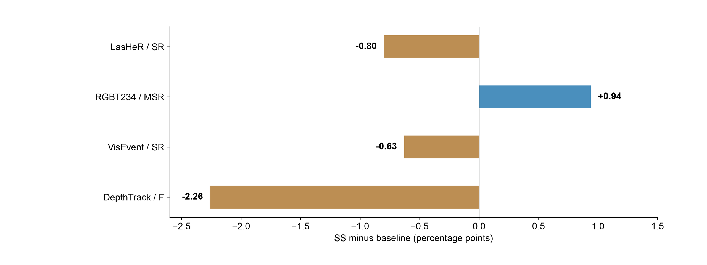
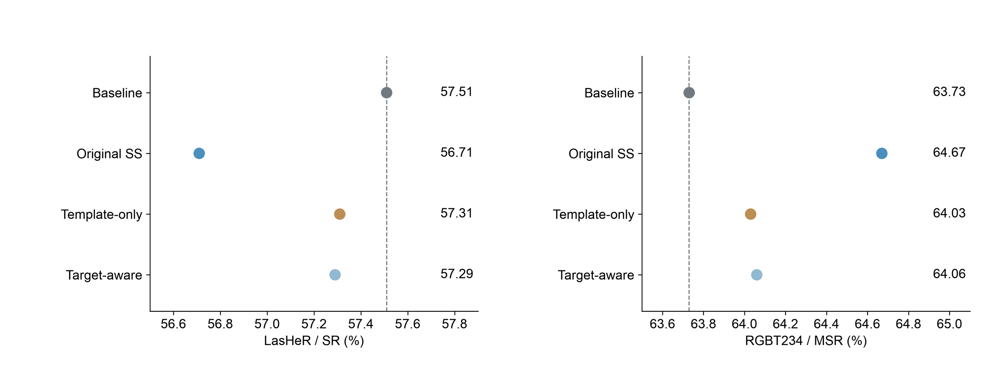
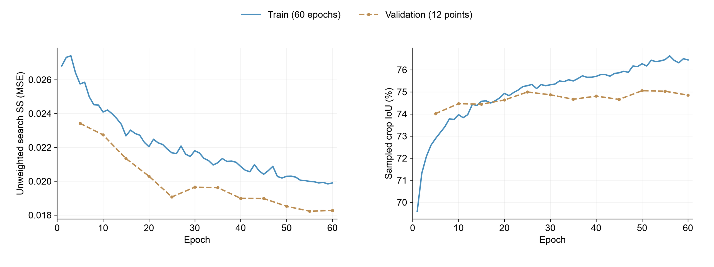
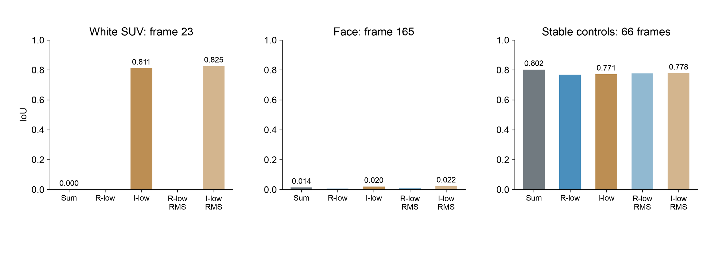

# source

- Source: `source.pptx`
- Total slides: 12

## Slide 1

SEATrack · 组会实验复盘 · 2026.11.18

SS、补救与频段融合

从“关系对齐能否帮助跟踪”到“哪些干预真正有效”

01 SS：先检验表征约束

原理 → 多数据集结果 → 逐序列失败分析

03 SS 补救：定位干扰来源

搜索框交换 → 区域／目标／层消融 → 收敛动态

02 频段融合：检验模态互补

固定特征融合 → 两参数决策图融合 → 闭环验证

汇报重点：每项实验为什么做、具体改了什么、结果支持什么结论。

已完成全量评测、已完成训练与诊断性回放分别标注；不将单帧改善当作总体收益。

编号对应师兄想法；汇报按“SS → 补救 → 频段”展开。

01

### Speaker Notes

这次按 SS、针对 SS 的补救、频段融合三部分汇报。编号对应师兄想法一、三、二。重点不是罗列做过什么，而是说明每项实验要排除什么解释，具体改变了哪一个环节，结果能支持什么结论。全量测试、只完成训练、单帧诊断分别说明，避免把不同强度的证据混在一起。

## Slide 2

想法 1 · Spatial Self-similarity / 训练时的跨模态关系校准

SS：让两模态保持一致的空间关系结构

a 特征 → 关系矩阵 → 训练约束

F_RGB

S = U · Uᵀ

通道归一化

S_RGB

U = normalize(F)

patch 两两余弦相似

MSE

L_SS

\[B,N,C\]

区域加权、层平均

关系一致性

S = U · Uᵀ

通道归一化

F_IR

S_IR

保留反向梯度

同一区域内的位置对

b 模板与搜索分别约束，不跨区域配对

c 五个 block 入口，共享同一计算规则

64 × 64 → L_t

权重 0.5

Template · 64

3

5

7

9

11

零基索引 → 第 4 / 6 / 8 / 10 / 12 层之前

256 × 256 → L_s

Search · 256

权重 0.5

L_SS = mean_layers(0.5 L_t + 0.5 L_s)

L_total = L_tracking + 0.1 L_SS

不增加参数；反传更新上游 PEFT；推理跳过 SS。

L_tracking = 2 GIoU + 5 L1 + Focal；FP32、eps = 1e−6、不 detach；矩阵包含对角和双向位置对。

关系矩阵为结构示意，非实测热图。原编码器 AMG/HMoE 与预测头保持；direct、无 CLS、CE 保留率 1。

02

### Speaker Notes

师兄想法一希望从特征表征层补充原模型的注意力响应对齐。目前实际实现的是 patch 两两空间自相似性，而不是平均池化或可学习 query 的语义 anchor。在原编码器选定 block 的入口取两路特征，各有六十四个模板 token 和二百五十六个搜索 token。分别沿通道归一化，用 U 乘 U 的转置得到关系矩阵，对两模态的矩阵计算 MSE。模板与搜索各占零点五，五个层位置平均后再乘零点一，加到原跟踪损失。原跟踪目标为二倍 GIoU、五倍 L1 与 Focal 之和。

SS 支路不直接修改本次前向特征，也没有额外参数；它保留梯度，优化上游可训练的 PEFT。关系矩阵包含对角线和上下三角，不包含模板与搜索的交叉位置对；FP32 计算，归一化 epsilon 为一乘十的负六次方，不做 detach。索引从零开始的三、五、七、九、十一，实际是第四、六、八、十、十二个 block 之前。常规推理跳过辅助损失。当前前提是 direct 布局、没有 CLS 且不裁剪 token。这些定义使后面的区域、目标和层消融都能复用同一个接口。

## Slide 3

想法 1 / 全量评测

SS 没有带来普遍提升：收益依赖数据集

目的：检验空间关系对齐能否提升跨模态跟踪。

做法：原跟踪损失 + 五层双区域 SS；RGB-T / RGB-E / RGB-D 分别训练 60 / 45 / 25 轮。

基线 → 初版 SS

LasHeR：57.51 → 56.71

RGBT234：63.73 → 64.67

VisEvent：60.26 → 59.63

DepthTrack：63.23 → 60.97

VOT2022-RGBD EAO（独立量纲）

0.73760 → 0.72659

下一步问题：是普遍小幅退化，还是少数失败序列持续跟偏？

序列配对重采样 95% 区间（百分点）：LasHeR \[−1.93, +0.18\]；RGBT234 \[+0.37, +1.58\]；VisEvent \[−1.37, +0.04\]。

区间只反映测试序列组成，不覆盖训练随机性；RGB-D / RGB-E 对照为历史基线，复现一致性仍有局限。

图中为百分比指标的配对差值；不同指标不作横向绝对优劣比较。来源：全量评测汇总。

03

### Speaker Notes

首先检验关系对齐能否改善完整跟踪。RGB-T、RGB-E、RGB-D 分别训练六十、四十五、二十五轮。结果不是普遍提高：LasHeR SR 从五十七点五一降到五十六点七一，RGBT234 MSR 从六十三点七三升到六十四点六七，VisEvent SR 从六十点二六降到五十九点六三，DepthTrack F 从六十三点二三降到六十点九七。VOT2022-RGBD 的 EAO 从零点七三七六零降到零点七二六五九。EAO 与百分比指标量纲不同，所以单独列出。

图表示每个数据集内的配对差值，不是跨不同指标直接排名。按序列配对重采样一万次，LasHeR 与 VisEvent 的差值区间都跨零，RGBT234 为正；这反映测试序列组成的不确定性，没有覆盖训练随机性。RGB-D 和 RGB-E 使用历史基线，可比性仍有局限。因此下一步要看，是普遍小幅变化还是少数序列长期跟偏拖低平均值。

## Slide 4

诊断 / 为什么退化，为补救找依据

搜索框交换：前序偏移与框内目标选择都有影响

逐序列：LasHeR 122 升／122 降／1 平，最差两条贡献约 −0.55 pp；VisEvent 最差五条贡献 −0.617 / 净 −0.635 pp。

白车从第 23 帧、人群从第 165 帧持续跟偏；足球连续 510 帧 IoU < 0.2，girl1 从第 60 帧至结尾连续 122 帧低于阈值。

目的：区分“上一帧定位偏移导致裁剪错误”和“在相同搜索区域内选错目标”。

固定输入

替换前一帧搜索框

两份固定权重

对比预测 IoU

首帧模板 + 当前帧

基线前框／SS 前框／GT 前框

基线／初版 SS

起点 −10 至 +15 帧

5 条失败序列，逐帧独立

控制搜索区域，GT 只作诊断

形成 2 × 3 组配对

无效标注跳过

白车第 23 帧：只换前框，即可改变成败

相同前框下，SS 仍可能选错目标

SS：自己的前框 0 → 基线前框 0.862

人群第 165 帧（同用 SS 前框）

基线：自己的前框 0.851 → SS 前框 0

基线 0.746；SS 0.014

起点后 16 帧平均：SS 用基线前框 0.831，用 SS 前框 0.009。

足球第 63 帧（同用基线前框）：基线 0.818；SS 0.031。

效果：支持“关键帧选错 → 搜索区偏移 → 后续持续失败”的过程解释。

这是非闭环诊断，不是补救算法，也不能单独证明 SS 损失导致退化；0/10/20/30% 人工偏移实验尚未执行。

持续跟偏：连续 5 帧基线 IoU ≥ 0.5 且 SS < 0.2；自前框回放坐标误差 < 10⁻⁶ px。

04

### Speaker Notes

逐序列结果显示失分有集中性。LasHeR 一百二十二条提高、一百二十二条下降、一条持平，最差两条贡献约负零点五五个百分点。VisEvent 最差五条贡献负零点六一七个百分点，接近总下降负零点六三五。白车和人群分别在第二十三帧、第一百六十五帧开始持续跟偏。持续跟偏定义为连续五帧基线 IoU 至少零点五，而 SS 小于零点二。

为了区分搜索区域偏移与框内选错目标，固定首帧模板及当前帧，将两份权重分别配上基线前框、SS 前框、GT 前框，形成二乘三组对照。选择五条失败序列，回放失败起点前十帧至后十五帧，跳过无效 GT。每帧独立，GT 只作诊断；用自己的原前框时能复现存档轨迹，最大误差小于十的负六次方像素。

白车第二十三帧，SS 只换成基线前框，IoU 就从零升到零点八六二；基线换成 SS 前框则由零点八五一变成零。失败起点及之后十五帧，SS 使用基线前框的平均 IoU 为零点八三一，使用自己的前框只有零点零零九。但相同搜索框下仍有识别差异：人群同用 SS 前框时基线零点七四六、SS 零点零一四；足球同用基线前框时基线零点八一八、SS 零点零三一。这支持关键帧目标选择和后续搜索区偏移共同作用，但不足以直接归因于 SS 损失。人工固定比例偏移实验尚未做，也不能将这个诊断直接称为闭环补救。

## Slide 5

想法 3 · 从区域选择，到目标关系筛选与逐层消融

SS 补救：约束放在哪里，哪些关系应该保留？

a 区域消融

b Target-aware：把搜索关系拆成目标相关与背景关系

保留分支用蓝色；去掉仅指直接 SS 项

FG

BG

Template-only

L_t

L_s = 0

FG–FG

FG–BG

覆盖率 p_i

加权关系 MSE

连续软权重

各组归一 → 平均有效组

Search-only

L_t = 0

L_s

BG–FG

去掉

保留区域的最终系数均为 0.05

GT 框覆盖 patch

模板 SS 保留；GT 仅训练时用于辅助项，不增加预测网络。

原跟踪前向仍使用模板与搜索

示意中按 FG/BG 分块便于理解；实际用连续覆盖率构造位置对权重。

实验

目的

做法（最终附加项）

效果／状态

Template-only

搜索区域 SS 是否带来干扰

0.05 × mean(L_t)

LasHeR SR 57.31%

Target-aware

背景–背景约束是否不利

0.05 × mean(L_t + L_s,target)

LasHeR SR 57.29%

Search-only

仅约束 query/search 是否有效

0.05 × mean(L_s)，五层平均

60 轮完成，测试待出分

Half-weight / 单层

区分强度因素、定位有效层

0.025 × mean(L_t+L_s) / 单层 SS

末轮未核验 / 配置已写

A/B 相对初版部分恢复，仍低于 LasHeR 基线；A 同时减弱总约束，需半权重对照排除混淆。

mean 为层平均；单层候选索引 3 / 5 / 7 / 9 / 11。矩阵与 GT patch 图均为机制示意。

05

### Speaker Notes

针对这个现象，把补救拆成区域、关系和层位置。A 只保留模板 SS，附加零点零五倍模板关系损失，用来检查搜索区域约束是否带来干扰。B 保留模板，同时用训练 GT 框的 patch 覆盖率给搜索关系加权：前景与前景、前景与背景、背景与前景分别归一，平均有效组，去掉背景与背景关系。它不新增目标预测网络，测试时也不需要 GT。

Search-only 则反过来去掉模板直接 SS，保留零点零五倍搜索关系损失，五层平均。它对应师兄建议先只对 query image 施加约束，目前六十轮训练已完成，但测试未出分。逐层版本分别只使用索引三、五、七、九、十一，配置已写，结果还没有。

A 的改变同时减少了搜索约束和总体损失强度，因此不能把收益单独归于移除搜索 SS。半权重对照保留两个区域，只将总系数减半，正是为了区分这两种解释；它已启动，但最终完成状态尚未核验。A/B 的全量结果在下一页。

## Slide 6

想法 3 / Template-only 与 Target-aware：已完成重训及全量评测

A/B 恢复部分 LasHeR 性能，但仍略低于基线

做法：同一 OSTrack 初始化、seed 0；60 轮 FP32；AdamW，lr 0.0004，第 48 轮衰减；有效批量 64，每轮 937 次更新。

评测：LasHeR 245 条 / 220,703 帧；RGBT234 234 条 / 116,649 帧；名单、帧数与标注指纹一致。

LasHeR：相对初版恢复

A +0.60 pp；B +0.58 pp

相对基线：−0.20 / −0.22 pp

RGBT234：初版收益缩水

A −0.64 pp；B −0.61 pp

相对基线仍为 +0.29 / +0.32 pp

虚线为基线；点图使用局部数值范围。

逐序列：LasHeR 相对初版 SS，A 为 119 升 / 125 降 / 1 平；B 为 123 升 / 118 降 / 4 平，改善数量没有明显占优。

失败案例：白车三组均在第 23 帧持续跟偏且未恢复；人群 A 未触发既定跟偏标准，B 在第 164 帧触发、未恢复。

结论：A/B 只能称为部分恢复；B 不优于 A，尚不能确认“背景–背景关系”就是退化原因。

A 未触发阈值不等于始终准确；以上为单次训练结果，没有跨 seed 稳定性结论。

指标为 %；pp 为百分点。A = Template-only；B = Target-aware。完整五指标列于讲稿备注。

06

### Speaker Notes

A/B 使用同一 OSTrack 初始化和 seed 零，训练六十轮，FP32、AdamW，学习率零点零零零四，第四十八轮衰减。每轮五万九千九百六十八个样本，有效批量六十四，九百三十七次更新。全量 LasHeR 为二百四十五条、二十二万零七百零三帧，RGBT234 为二百三十四条、十一万六千六百四十九帧，评测名单与标注指纹已核对。

LasHeR 上，A 和 B 的 SR 分别为五十七点三一和五十七点二九，比初版 SS 恢复零点六零、零点五八个百分点，但仍比未加 SS 基线低零点二零、零点二二。RGBT234 上，A/B 分别为六十四点零三和六十四点零六，仍略高于基线，却低于初版 SS。这不是两组都不如基线，而是不同数据集有不同取舍。

完整指标依次为 LasHeR PR、NPR、SR 和 RGBT234 MPR、MSR。基线为七十一点五七、六十七点八三、五十七点五一、八十六点一四、六十三点七三；初版 SS 为七十点五一、六十七点零零、五十六点七一、八十七点三三、六十四点六七；A 为七十一点四三、六十七点六二、五十七点三一、八十六点九七、六十四点零三；B 为七十一点三五、六十七点七六、五十七点二九、八十六点七五、六十四点零六。

逐序列看，相对初版 SS，A 一百一十九升、一百二十五降、一平；B 一百二十三升、一百一十八降、四平，并没有明显普遍改善。白车两组仍在第二十三帧跟偏且未恢复；人群 A 没有触发既定跟偏阈值，不等于始终准确；B 第一百六十四帧触发，之后未恢复。B 并不优于 A，因此尚不能确定背景与背景关系就是问题根源。

## Slide 7

想法 3 / Search-only：2026.11.18 核验 60/60 轮完成，测试尚未出分

SS 关系损失在下降，验证 IoU 已进入平台期

目的：验证“只约束搜索区域”，并记录 SS 训练动态。

做法：去掉模板 SS；五个 block 入口取搜索关系 MSE，附加损失为 0.05 × 层平均。

效果：训练搜索 SS：0.02681 → 0.01990；验证：0.02342（ep5）→ 0.01827（ep60）；末轮验证 IoU 0.74854。

尺度：末轮加权 SS 约占总损失 0.10%（训练）/ 0.08%（验证）；数值占比小不代表梯度影响小，尚无梯度范数与夹角。

可比性：本次 1,875 次更新/轮，A/B 为 937 次；须匹配预算。训练完成不等于 LasHeR / RGBT234 跟踪性能提升。

全部 60 个训练点、12 个验证点；epoch 样本加权均值，无平滑。裁剪样本 IoU ≠ 完整序列 SR。

07

### Speaker Notes

Search-only 已核验完成六十轮训练和末轮验证，权重已生成，完整跟踪测试尚未出分。目的有两个：检查仅搜索区域约束，以及记录 SS 优化过程。图中使用全部六十个训练轮均值和每五轮一次的十二个验证点，没有平滑。

训练搜索 SS 从零点零二六八一下降到零点零一九九零；验证从第五轮零点零二三四二下降到末轮零点零一八二七。训练 IoU 上升，验证 IoU 较早进入平台期，末轮为零点七四八五四。末轮训练总损失一点零三七二零、验证一点一四零零一；加权 SS 分别零点零零零九九和零点零零零九一，占总损失约零点一和零点零八个百分点的百分比数值。

这说明关系约束能被优化，但不能证明完整序列跟踪改善。损失占比也不能直接推断梯度贡献，因为不同损失的导数尺度不同，尚未记录同一可训练参数上的梯度范数和夹角。还有预算差异：本次每轮一千八百七十五次更新，而 A/B 是九百三十七次；应匹配更新次数再判断方法差异。图里的裁剪样本 IoU 不能替代完整序列 SR。

## Slide 8

想法 2 · 固定特征频段互换 / 用相同规则检验跨模态互补

频段融合：选取两模态的不同频段，再回到空域预测

a 图示一组组合：RGB 低频 + 红外高频；反向组交换两种掩膜

× M

rFFT2

逐通道 16 × 16

保留低频

irFFT2

原预测头

RGB 特征

+

可选 RMS 幅值匹配

Hann → 框 → IoU

× (1−M)

rFFT2

IR

混合复数频谱

保留高频

复数频谱

b 掩膜定义与对照

c 失败窗 + 稳定对照

d 固定前框，逐帧独立回放

M = 1：径向频率 ≤ 0.25 周期/格

白车 18–28；人群 160–170 帧

固定模板、当前帧与存档 SS 前框。

保留完整复数系数，不只混合幅值。

关键失败帧各 ±5，共 22 帧。

基线和初版 SS 两份权重都测试。

原相加 / 两个互换方向

稳定：两原模型 45–55 帧 IoU 均 ≥0.65

同一规则用于失败窗和稳定窗；

+ 两个方向的 RMS 匹配版 = 5 组

按序列名取前 6 条，共 66 帧。

不根据“是否失败”决定如何融合。

RMS：排除仅靠幅值变化的解释。

8 段，共 88 帧 × 2 权重 × 5 方案

共 880 次预测；不是闭环／全量结果。

圆形为中心化频域的掩膜示意，非实测频谱；实现为 rFFT 紧凑存储。RGB / IR 色彩仅表示来源。

此页为已完成的历史特征层诊断；后续独立无 SS 模块另行验证。

08

### Speaker Notes

频段实验首先检验一个简单假设：RGB 低频与红外高频是否存在互补，反向组合是否也有用。保持编码器和预测头不变，对两路末层搜索特征按通道恢复十六乘十六空间网格，做二维实数 FFT，保留复数频谱的幅值与相位。以零点二五周期每格作为径向截止，低频硬掩膜与高频补集分别选两模态，逆变换后进入原预测头与 Hann 解码。比较原相加、两个互换方向，以及这两个方向的 RMS 幅值匹配版，总共五种。

这不是针对某个失败帧手写一种特殊规则；同一个方案对失败窗和稳定窗一视同仁。但样本本身是有意选择的诊断窗口。白车取十八至二十八帧，人群取一百六十至一百七十帧，共二十二帧。稳定对照要求两版原模型在四十五至五十五帧的每一帧 IoU 都至少零点六五，按序列名排序取前六条，共六十六帧。八十八帧乘两份权重乘五方案，总计八百八十次预测。

所有方案固定同一模板、当前帧和存档 SS 前框，每帧独立，不让新预测影响下一帧搜索区域。RMS 对照用于排除仅靠幅值变化改善的解释。它是非随机、非闭环的观察实验，不能估计整个 benchmark 的增益，也不与后来独立无 SS 模块的结果混用。

## Slide 9

想法 2 / 固定融合结果：初版 SS 权重，所有方案使用同一搜索前框

白车可以救回；人脸未恢复，稳定片段反而退化

Sum = 原相加；R-low = RGB 低频 + 红外高频；I-low = 红外低频 + RGB 高频；RMS = 匹配原融合特征幅值。

三个面板分别检验：失败帧能否救回、能否迁移到另一类失败、是否损伤原本稳定的跟踪。

局部效果：I-low 白车关键帧 0 → 0.811，RMS 后 0.825；11 帧白车均值 0.410 → 0.471，RMS 后 0.475。

反例：I-low 人脸 11 帧均值 0.376 → 0.325；稳定 66 帧 0.802 → 0.771（RMS 后 0.778），仍低于原相加。

基线权重也有类似局限：I-low 白车关键帧 0 → 0.806，但稳定均值 0.802 → 0.754；不支持固定模态频段分工。

均为 IoU；单个失败关键帧与稳定窗口均值的样本量不同，不作总体平均或显著性比较。

09

### Speaker Notes

这里展示初版 SS 权重下全部五种规则。红外低频加 RGB 高频将白车第二十三帧 IoU 从零提升到零点八一一，匹配 RMS 后是零点八二五，说明这个局部修复不完全由幅值变化造成。白车十一帧平均也由零点四一零提高到零点四七一，RMS 后零点四七五。

但在人群失败帧上各方案仍接近零；对应十一帧平均，反向互换从零点三七六降到零点三二五。稳定六十六帧平均也从零点八零二降到零点七七一，RMS 后零点七七八仍低于原相加。基线权重也出现类似边界：白车可救回至零点八零六，而稳定均值从零点八零二降至零点七五四。

因此现有证据只说明某些频段组合能修复某些局部错误，不能支持普遍固定的模态频段分工。三个面板分别是单帧、另一单帧与六十六帧平均，不把它们合并成一个总体均值，也不声称显著性。

## Slide 10

想法 2 · Learnable decision-map fusion / 冻结主模型，仅拟合两个全局参数

决策图融合：让数据决定低频与高频的模态占比

a 融合位置从特征层改到中心分类 logits；不是逐帧自适应门控

SEATrack

中心分类头

z_RGB

两参数频域混合

逆 FFT → 融合中心图

→ FFT

同一套冻结参数

初版 SS · ep60

w_low / w_high

尺寸 / 偏移仍取原版

参数冻结

Hann + 原框解码

RGB 权重 w，红外权重 1−w

中心分类头

z_IR

截止 0.25；完整复数系数

进入完整闭环评测

RGB / IR search

→ FFT

sigmoid 前输出

b 每个频段只学一个全局模态占比

c 用分类损失拟合，再用跟踪轨迹验证

低频：w_low = 0.97319

训练 48 条 / 384 帧

验证 16 条 / 128 帧

Adam · 150 次更新 · 仅 2 参数

序列分离，均排除测试名单

高频：w_high = 0.26820

梯度有限且非零；FFT / 逆 FFT 可回传梯度。

融合系数：w·F_RGB + (1−w)·F_IR

闭环：首帧初始化，此后使用自身上一帧预测框。

偏好来自拟合样本，不等于“所有帧固定分工都有效”。

CE 下降是否转化为整段 SR 提升？见下一页结果。

得分图小方块与中心频段图均为结构示意，非实测响应；权重为实际拟合值。

本实验作用于决策图，与历史 768 通道特征层互换分别评价。

10

### Speaker Notes

固定二选一可能过于刚性，所以另做了两参数决策图融合。这里改变了融合层级：冻结初版 SS 第六十轮模型，两路末层搜索特征分别经过同一个中心分类头，得到 sigmoid 之前的 logits，对中心得分图做 FFT。低频和高频分别只有一个全局 RGB 权重，红外占比为其补数。逆变换得到中心图，尺寸、偏移、Hann 窗和解码沿用原版。这不是每帧自适应的门控网络。

从四十八条训练序列取三百八十四帧，用 Adam 更新一百五十次，只拟合两个参数；验证使用另外十六条序列的一百二十八帧，均排除测试名单。梯度有限且非零，因此 FFT 和逆 FFT 的可微性在实现上没有障碍。学得 RGB 低频权重零点九七三一九、高频权重零点二六八二零，表现出 RGB 偏低频、红外偏高频的拟合倾向，但仍需看完整闭环是否有用。

## Slide 11

想法 2 / 决策图融合：拟合效果与两条序列闭环

验证 CE 降了，但单帧修复没有转化为整段收益

a 分类拟合：CE 越低越好

b 闭环验证：每步使用自身上一帧预测框

whitesuvturn · 137 帧

方案

训练

验证

关键帧 IoU：0 → 0.86151

2.93525

2.72052

等权

整段 SR：15.5718% → 15.5718%

2.86395

2.73506

RGB 低 + 红外高

1blackteacher · 851 帧

3.13950

2.81659

红外低 + RGB 高

关键帧 IoU：0.01379 → 0.01518

整段 SR：16.0539% → 16.0651%

2.85214

2.69162

学习融合

效果：拟合目标改善，局部响应有变化；目前没有可报告的整体跟踪增益。

白车关键帧救回但 SR 完全相同，说明后续轨迹仍有失败；两条案例不能代替全量评测，也不能据此解释全部失败机制。

闭环比较为初版 SS 原预测 → 学习决策图融合；不同于上一页固定前框的单帧回放。

独立无 SS 频段模块：实现已具备，结果仍待补齐

已实现关闭融合／等权／RGB 低／红外低四配置；等权直接返回原相加，固定融合逆变换使用 gain = 2。

15 项 CPU 检查通过；真实权重轨迹一致性、CUDA 与全量 benchmark 尚未核验，不与上面历史诊断数字混用。

来源：两参数拟合记录与闭环 pilot。频域全量正式报告尚无已核验结果。

11

### Speaker Notes

先看拟合目标：学习融合的训练 CE 为二点八五二一四、验证 CE 为二点六九一六二；等权验证为二点七二零五二，固定 RGB 低频为二点七三五零六，固定红外低频为二点八一六五九。学习权重降低了验证分类损失，但分类目标下降不等于轨迹更好。

随后对两条失败序列做闭环复查：首帧初始化，此后每步用自身上一帧预测框。白车共一百三十七帧，关键帧 IoU 从零到零点八六一五一，但整段 SR 都是百分之十五点五七一八；人群八百五十一帧，关键帧零点零一三七九到零点零一五一八，整段 SR 仅从百分之十六点零五三九到百分之十六点零六五一。这说明单帧救回没有形成有意义的整段收益，两条案例也不能估计总体提升。

另一个独立无 SS 特征融合模块已写好关闭、等权和两种方向四个配置。等权直接返回原相加，固定混合逆变换使用二倍增益；十五项 CPU 检查通过，但真实权重轨迹一致性、CUDA 和全量评测尚未核验。它与上面冻结 SS 模型的历史诊断不同，不借用历史数字当作该模块的正式效果。

## Slide 12

结论 / 已有证据与下一步

先证明可复现的跟踪收益，再扩大或组合方法

想法 1 · SS

实现了关系约束，但没有获得普遍增益。

已做：五层 pairwise SS、三类模态训练、五数据集结果与逐序列失败分析。

证据：RGBT234 改善，LasHeR / VisEvent / RGB-D 退化；关系损失下降不能直接说明跟踪更好。

当前为 patch–patch 关系矩阵；师兄提出的平均池化／可学习 query 语义 anchor 版本尚未实现。

想法 3 · 补救

A/B 部分恢复；search-only 收敛，跟踪效果待测。

已做：搜索框交换、A/B 重训与全量测评、search-only 60 轮及训练动态。

优先：search-only 全量测评；核验半权重末轮，匹配更新次数，再做单层消融。

补记录：同一可训练参数上的 tracking / SS 梯度范数与夹角，判断尺度及优化冲突。

想法 2 · 频段

存在局部互补，但固定分工不稳，闭环收益尚未建立。

已做：固定特征互换 + RMS 对照、两参数决策图拟合、两条序列闭环。

优先：同一无 SS 权重下核验“原相加 = 等权”轨迹，再比较两方向频段并完成全量测评。

先在一个 benchmark 上筛选有效设置，再扩展数据集；不以挑选的失败帧决定方法有效性。

目前可以说“找到了退化现象和部分边界”，还不能说“SS 补救或频段融合已解决问题”。

12

### Speaker Notes

目前对师兄可以这样概括：想法一已实现空间关系 SS，但没有普遍跟踪增益；它是 patch 两两关系矩阵，语义 anchor 版本尚未实现。失败分析找到目标选择与后续搜索偏移共同作用的现象，但不能据此直接证明 SS 的因果机制。

想法三的 A/B 补救在 LasHeR 恢复了部分损失，仍略低于基线；search-only 训练已完成，测试待做。下一步先补它的完整评测，核验半权重末轮，统一更新预算，再逐层消融。同时记录同一可训练参数上两个目标的梯度范数与夹角，回答损失尺度和优化冲突问题。

想法二表明有局部频域互补，却没有建立稳定闭环增益。下一步用同一无 SS 权重先验证原相加与等权轨迹一致，再比较双向频段，完成一个 benchmark 的全量评测，有效果再扩展。当前最准确的结论是找到了失败现象和方法边界，尚未证明补救或融合已经解决问题。
